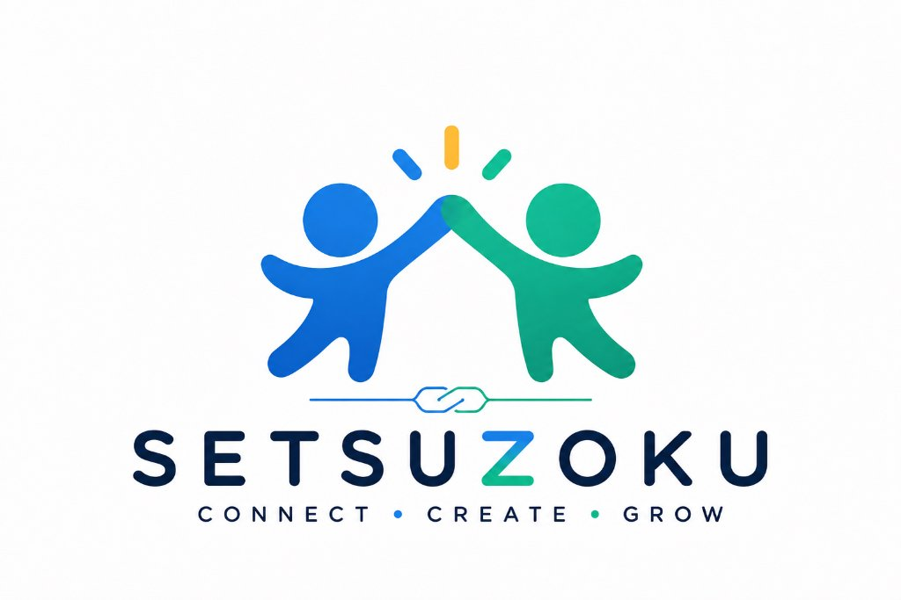
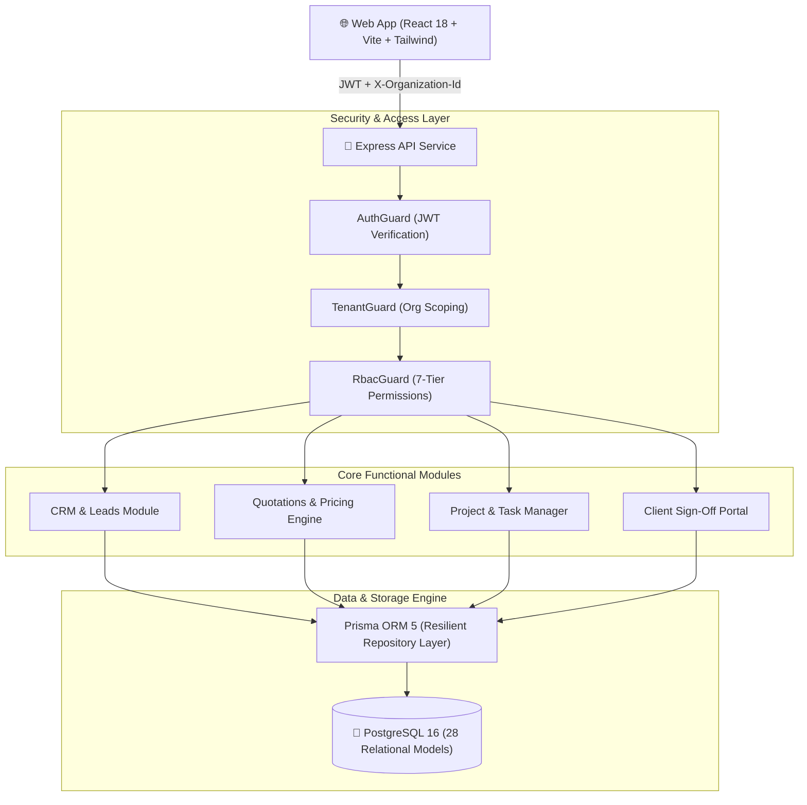

<div align="center">

  

  # SETSUZOKU OS (接続 OS)

  <p align="center">
    <strong>From First Inquiry to Final Payment.</strong><br/>
    <em>The unified multi-tenant operating system built for modern service agencies, IT firms, creative studios, and consultancies.</em>
  </p>

  <p align="center">
    <a href="https://setsuzokuos.vercel.app"></a>
    <a href="https://setsuzoku.info"></a>
    
    
  </p>

  <p align="center">
    
    
    
    
    
    
    
  </p>

  <h3>
    <a href="https://setsuzokuos.vercel.app">Launch App</a>
    <span> &bull; </span>
    <a href="#-system-architecture">Architecture</a>
    <span> &bull; </span>
    <a href="#-quick-start">Quick Start</a>
    <span> &bull; </span>
    <a href="docs/API_DOCUMENTATION.md">API Docs</a>
    <span> &bull; </span>
    <a href="docs/PRD.md">Product Specs</a>
  </h3>

</div>

---

## 🎯 Executive Overview

**SETSUZOKU OS** eliminates enterprise tool fragmentation by unifying CRM, Quotations, Project Management, Client Review Portals, and Invoicing into an audit-trailed, single-pane operating system.

### 🔄 The Continuous Customer Journey


---

## ✨ Core Pillars & Differentiators

| Pillar | Capability | Technical Guarantee |
| :--- | :--- | :--- |
| 🪙 **Decimal-Safe Financial Engine** | Server-side monetary arithmetic for quotations, tax rates, and line items. | Enforces PostgreSQL `Decimal(12, 2)` across all calculations—eliminating floating-point inaccuracies. |
| 🏢 **Ironclad Multi-Tenancy** | Strict tenant scoping across every query and entity. | Row-level tenant foreign keys enforced by authentication middleware and `TenantGuard` (`X-Organization-Id`). |
| 🛡️ **7-Tier Granular RBAC** | Role hierarchy: `SUPER_ADMIN`, `ORGANIZATION_OWNER`, `ADMIN`, `MANAGER`, `EMPLOYEE`, `FINANCE`, `CLIENT`. | Guarded at route decorators with active safeguards against deleting or demoting sole owners. |
| 🔄 **Client Sign-Off State Machine** | Multi-version deliverable history (`v1`, `v2`, `v3`...) with immutable audit trails. | Approved deliverables cannot be overwritten without an explicit new version increment. |
| 🌐 **Dedicated Client Portal (`/portal`)** | Isolated, branded portal where external clients review deliverables and approve proposals. | Strict data isolation prevents access to internal team tasks, discussions, and margins. |

---

## 🏗️ System Architecture

SETSUZOKU OS is engineered as a high-performance modular monolith inside a clean `pnpm` monorepo:



---

## 📁 Repository Structure

```
setsuzoku-os/
├── apps/
│   ├── api/                 # Node.js/Express REST API (JWT, RBAC & Tenant Guards)
│   └── web/                 # React 18 SPA (Vite, Tailwind CSS, TanStack Query)
├── packages/
│   ├── database/            # PostgreSQL Prisma schema (28 models), Migrations & Client
│   └── shared/              # Shared Zod schemas, RBAC enums, DTOs & Permissions
├── brand/                   # Official brand guidelines, logos & icon assets
├── docs/                    # Exhaustive specifications & engineering docs
│   ├── PRD.md               # Product Requirements Document
│   ├── SYSTEM_ARCHITECTURE.md # Architecture deep-dive
│   ├── DATABASE_ERD.md      # Relational Schema & Mermaid ER Diagram
│   ├── API_DOCUMENTATION.md # Complete REST API Reference (/api/v1/...)
│   └── AUTH_AND_RBAC.md     # 7 Roles & Permission Matrix
└── README.md
```

---

## 🚀 Quick Start

### Prerequisites
- **Node.js**: $\ge 20.0.0$ (v20+ or v25+ recommended)
- **Package Manager**: `pnpm` ($\ge 9.0.0$)
- **Database**: PostgreSQL 16+ (or Supabase / Neon / Docker container)

### 1. Clone & Install

```bash
# Clone the repository
git clone https://github.com/ukk1019-yhat/setsuzokuos.git
cd setsuzokuos

# Install workspace dependencies
pnpm install
```

### 2. Configure Environment

Copy `.env.example` in both backend and frontend applications:

```bash
cp apps/api/.env.example apps/api/.env
```

### 3. Build Shared Packages & Prisma Client

```bash
# Build shared types and contracts
pnpm --filter @setsuzoku/shared run build

# Generate Prisma Client & compile database package
pnpm --filter @setsuzoku/database run build
pnpm --filter @setsuzoku/database exec prisma generate --schema=prisma/schema.prisma
```

### 4. Start Local Development

Launch both API server (port 4000) and Web Frontend (port 3000) concurrently:

```bash
pnpm dev
```

Open [http://localhost:3000](http://localhost:3000) in your browser.

---

## 🧪 Testing & Verification

Run the full automated test suite (including multi-tenant isolation and RBAC checks):

```bash
# Run tests across all packages
pnpm test

# Target API test suite with Vitest
pnpm --filter @setsuzoku/api run test
```

---

## 📚 Deep Dive Documentation

<details>
  <summary><strong>🔐 Click to expand 7-Tier RBAC Permission Structure</strong></summary>

| Role | Scope & Permissions |
| :--- | :--- |
| `SUPER_ADMIN` | Platform-wide administration and global metrics. |
| `ORGANIZATION_OWNER` | Complete organization ownership, billing, legal profile, and member management. Protected against demotion. |
| `ADMIN` | Organization configuration, team invites, and workflow defaults. |
| `MANAGER` | Project allocations, task assignments, lead stage progression, and deliverables dispatch. |
| `EMPLOYEE` | Task execution, checklist updates, deliverable submissions, and internal discussions. |
| `FINANCE` | Quotations management, tax profile, invoice issuance, and payment verification. |
| `CLIENT` | External client portal access (`/portal`): quotation approvals, deliverable sign-offs, and revision feedback. |

</details>

<details>
  <summary><strong>🗄️ Click to expand Database Model & Schema Architecture</strong></summary>

The PostgreSQL database is normalized into 28 models across five core domains:
1. **Tenancy & Auth:** `User`, `Organization`, `OrganizationMember`, `Session`, `AuditLog`.
2. **CRM & Intake:** `Lead`, `LeadActivity`, `LeadStageTransition`, `ClientProfile`.
3. **Financials & Estimates:** `Quotation`, `QuotationItem`, `TaxProfile`, `PaymentTerm`.
4. **Operations & Delivery:** `Project`, `ProjectMilestone`, `Task`, `TaskComment`, `Subtask`.
5. **Quality & Approvals:** `Deliverable`, `DeliverableVersion`, `ClientApprovalDecision`.

All monetary amounts utilize `@db.Decimal(12, 2)` to guarantee mathematical exactness.

</details>

---

## 🗺️ Roadmap & Phase Status

- [x] **Phase 1: Foundation, Multi-Tenant Auth & RBAC** (Complete)
- [x] **Phase 2: CRM, Leads Pipeline & Quotations Engine** (Complete)
- [x] **Phase 3: Project Execution, Task Engine & Dedicated Client Portal** (Complete)
- [ ] **Phase 4: Invoicing, Automated Ledger & Tax Invoices (GST/VAT)** (In Progress)
- [ ] **Phase 5: Automated Payment Gateway Webhooks & Analytics** (Planned)

---

## 🏢 Corporate Entity & Support

- **Corporate Website:** [https://setsuzoku.info](https://setsuzoku.info)
- **Live Platform:** [https://setsuzokuos.vercel.app](https://setsuzokuos.vercel.app)
- **Official Desk:** [info@setsuzoku.in](mailto:info@setsuzoku.in)
- **Company:** Setsuzoku Media Labs Private Limited (Republic of India)

---

## 📄 License

Distributed under the **MIT License**. See [`LICENSE`](./LICENSE) for full details.

<div align="center">
  <sub>Built with precision by <strong>Setsuzoku Media Labs</strong></sub>
</div>
