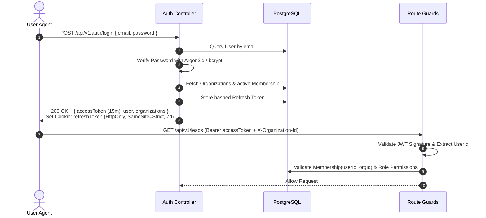

# SETSUZOKU OS - Authentication & RBAC Architecture
**Version:** 1.0.0 | **Model:** Multi-Tenant Role-Based Access Control

---

## 1. Authentication Lifecycle

### 1.1 Dual-Token Architecture


### 1.2 Multi-Organization Membership
A single user identity can belong to multiple organizations (e.g., an agency owner managing two businesses, or a freelance contractor working with multiple agencies).
- Every query executes against the active tenant specified via the `X-Organization-Id` HTTP header.
- The `TenantGuard` verifies that `Membership` exists, is active (`isActive: true`), and resolves the user's role in that specific organization.

---

## 2. Role-Based Access Control (RBAC) Matrix

### 2.1 The Seven Roles
1. `SUPER_ADMIN`: Internal platform administrator (cross-tenant maintenance, billing overrides).
2. `ORGANIZATION_OWNER`: Founding owner with unrestricted authority over their organization.
3. `ADMIN`: Senior operational leader (can manage employees, clients, projects, invoices).
4. `MANAGER`: Departmental/project leader (manages tasks, reviews deliverables, delegates).
5. `EMPLOYEE`: Individual contributor (updates assigned tasks, uploads deliverables).
6. `FINANCE`: Dedicated accountant/bookkeeper (handles quotations, invoices, payments, revenue reports).
7. `CLIENT`: External client with restricted access only to their own organization's deliverables, quotations, and invoices via Client Portal.

### 2.2 Permissions Matrix
| Resource Action | SUPER_ADMIN | ORG_OWNER | ADMIN | MANAGER | EMPLOYEE | FINANCE | CLIENT |
| :--- | :---: | :---: | :---: | :---: | :---: | :---: | :---: |
| `org:settings:update` | ✅ | ✅ | ❌ | ❌ | ❌ | ❌ | ❌ |
| `members:invite` | ✅ | ✅ | ✅ | ❌ | ❌ | ❌ | ❌ |
| `members:roles:update`| ✅ | ✅ | ❌ | ❌ | ❌ | ❌ | ❌ |
| `leads:read` | ✅ | ✅ | ✅ | ✅ | ✅ | ❌ | ❌ |
| `leads:write` | ✅ | ✅ | ✅ | ✅ | ❌ | ❌ | ❌ |
| `clients:manage` | ✅ | ✅ | ✅ | ✅ | ❌ | ❌ | ❌ |
| `quotations:create` | ✅ | ✅ | ✅ | ❌ | ❌ | ✅ | ❌ |
| `quotations:accept` | ✅ | ✅ | ❌ | ❌ | ❌ | ❌ | ✅ (Own) |
| `projects:create` | ✅ | ✅ | ✅ | ✅ | ❌ | ❌ | ❌ |
| `projects:view` | ✅ | ✅ | ✅ | ✅ | ✅ (Assigned)| ✅ | ✅ (Own) |
| `tasks:update` | ✅ | ✅ | ✅ | ✅ | ✅ (Assigned)| ❌ | ❌ |
| `deliverables:submit` | ✅ | ✅ | ✅ | ✅ | ✅ | ❌ | ❌ |
| `deliverables:approve`| ✅ | ✅ | ❌ | ❌ | ❌ | ❌ | ✅ (Own) |
| `invoices:create` | ✅ | ✅ | ✅ | ❌ | ❌ | ✅ | ❌ |
| `payments:record` | ✅ | ✅ | ✅ | ❌ | ❌ | ✅ | ❌ |
| `reports:financial` | ✅ | ✅ | ✅ | ❌ | ❌ | ✅ | ❌ |

---

## 3. Backend Enforcement Pattern

Authorization is strictly enforced in the backend controller layer using decorators:

```typescript
@UseGuards(JwtAuthGuard, TenantGuard, PermissionsGuard)
@Permissions('projects:create')
@Post()
async createProject(
  @CurrentTenant() tenant: TenantContext,
  @Body() dto: CreateProjectDto
) {
  return this.projectService.create(tenant.organizationId, dto);
}
```
Front-end controls conditionally hide or disable UI elements, but the backend is the authoritative source of truth.

