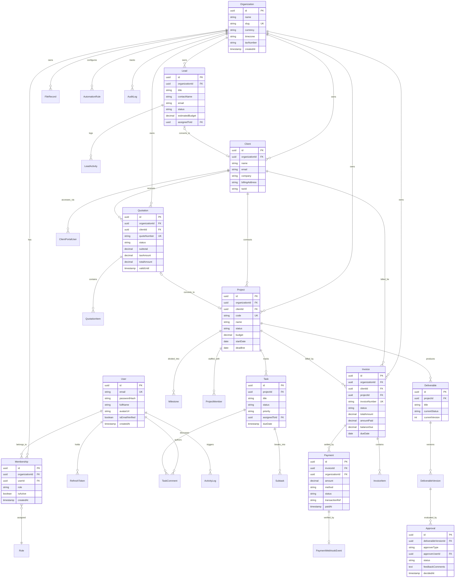

# SETSUZOKU OS - Database Entity Relationship (ER) Diagram
**Version:** 1.0.0 | **RDBMS:** PostgreSQL 16+ via Prisma ORM

---

## 1. High-Level Entity-Relationship (ER) Diagram

---

## 2. Key Relational Integrity Constraints & Rules

1. **Strict Organization Scoping:**
   - Every primary domain model (`Client`, `Lead`, `Quotation`, `Project`, `Invoice`, `Payment`, `Deliverable`, `FileRecord`) has a non-nullable `organizationId` foreign key referencing `Organization(id)` with `onDelete: Cascade`.
2. **Immutability of Financial & Approval Logs:**
   - Invoices, Payments, Approvals, and Audit Logs cannot be deleted if referenced in active transactions.
   - Deleting a project does NOT delete historical paid invoices or completed payments (`onDelete: Restrict` or archived state).
3. **Decimal Precision:**
   - All monetary fields use PostgreSQL `DECIMAL(12, 2)` to guarantee exact accounting balances.
4. **Auditability:**
   - Every table maintains `createdAt` and `updatedAt`.
   - Modifying actions write structured JSON records to `AuditLog`.

