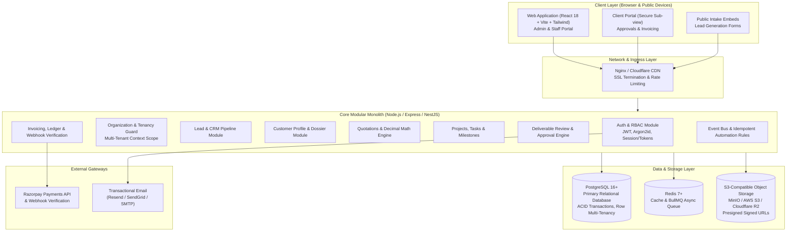
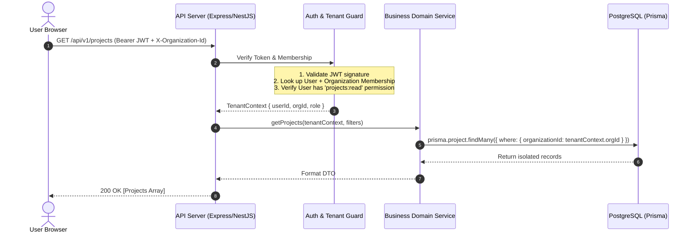

# SETSUZOKU OS - System Architecture Specification
**Document Version:** 1.0.0 | **Architecture:** Modular Monolith SaaS

---

## 1. High-Level Architecture Overview

SETSUZOKU OS adopts an **Enterprise Modular Monolith** architecture. This avoids the operational complexity, network latency, and distributed transaction failure modes of premature microservices while enforcing strict domain boundaries through modular TypeScript layers.

---

## 2. Multi-Tenancy & Data Isolation Model

### 2.1 The Row-Level Shared Database Strategy
SETSUZOKU OS employs row-level tenant isolation using foreign key scoping on `organizationId`. 
Why this pattern?
1. **Resource Efficiency:** High density on database connections; scalable to thousands of tenant organizations without individual schema migration overhead.
2. **Atomic Backups & Cross-Org Analytics:** Super-admin platform operations remain cohesive.
3. **Strict Isolation Guards:**
   - Every table representing tenant data includes an `organizationId UUID` column indexed with `@@index([organizationId])` or composite indexes `@@index([organizationId, createdAt])`.
   - The application context injects an authenticated `tenantId` into `req.tenant` via `TenantMiddleware`.
   - Prisma Client Extensions (`$extends`) or Repository Wrappers automatically append `{ where: { organizationId: req.tenant.id } }` on every mutation and query.
   - Any query attempting to access or modify data belonging to another tenant without `SUPER_ADMIN` privileges fails with an HTTP 403 `ForbiddenException`.

---

## 3. Layered Application Structure

The application is structured into four distinct, testable layers:

1. **Transport Layer (`controllers` / `routes`)**:
   - Accepts HTTP requests.
   - Performs route-level schema validation using Zod DTOs.
   - Handles HTTP headers, status codes, and serialization.
   - Absolutely no business logic.

2. **Security & Context Layer (`guards`, `middlewares`)**:
   - `JwtAuthGuard`: Verifies token signature, expiration, and blacklisting.
   - `TenantGuard`: Resolves active organization, validates membership, attaches tenant context.
   - `RolesGuard` / `PermissionsGuard`: Enforces fine-grained permission matrix.

3. **Domain Service Layer (`services`)**:
   - Pure business logic, decimal calculations, state machine transitions.
   - Manages database transactions (`prisma.$transaction`).
   - Dispatches domain events (e.g., `quotation.accepted`, `deliverable.approved`).

4. **Persistence Layer (`prisma` models & repositories)**:
   - Encapsulates database queries.
   - Applies strict constraints, foreign keys, and indexes.

---

## 4. Financial & Decimal Safety Architecture

Floating point operations in JavaScript (`0.1 + 0.2 = 0.30000000000000004`) are catastrophic in SaaS financial applications.
SETSUZOKU OS enforces:
1. **Database Type:** All monetary amounts (rates, discounts, taxes, totals, balances) are stored as `Decimal(12, 2)` in PostgreSQL.
2. **Application Type:** Calculations are computed using `decimal.js` or fixed-point integer cents/paise:
   $$\text{Total} = \sum (\text{Qty} \times \text{Unit Price}) - \text{Discount} + \text{Tax}$$
3. **Receipt & Audit Trail:** Every payment transaction stores an immutable ledger entry with the exact timestamp, payment method, gateway transaction ID, and balance before/after.

---

## 5. File & Deliverable Storage Pipeline

Files are **never** stored in the database or server filesystem directly:
1. Client requests a presigned upload URL from `/api/v1/files/presigned-upload`.
2. Backend validates mime type, file extension, and file size quota.
3. Client directly uploads the binary to S3/MinIO using the presigned URL.
4. Client notifies `/api/v1/files/confirm` with file metadata, key, and hash.
5. Deliverable downloads are served via expiring presigned URLs (15-minute TTL) with strict role checks.

